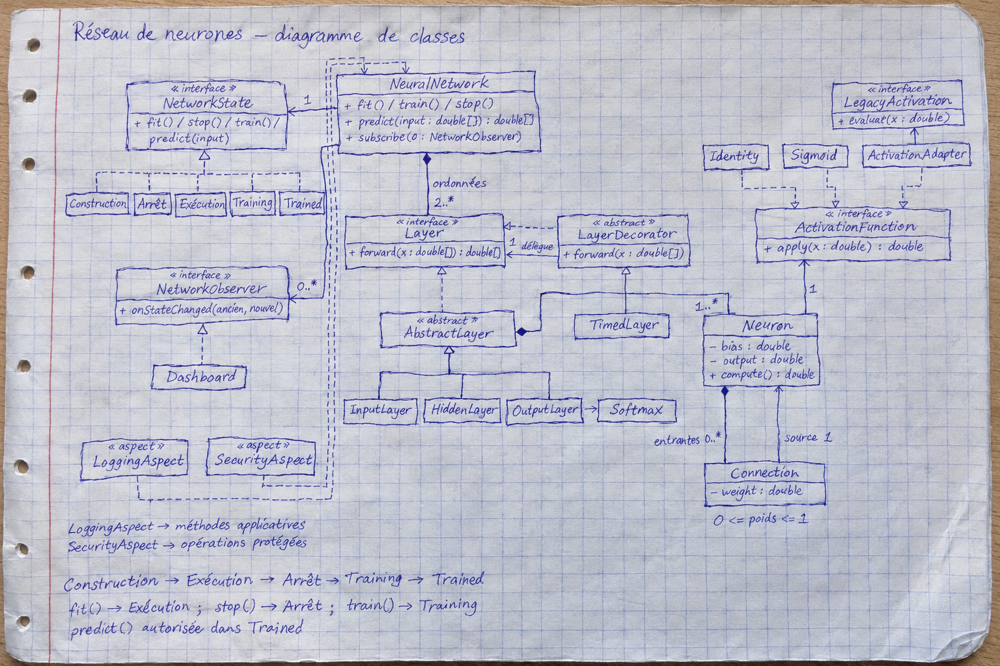

# Examen de design patterns

## Question 1 — Diagramme de classes

Établir un diagramme de classes d’un réseau de neurones artificiels en appliquant les patrons adaptés aux conditions du sujet.

`NeuralNetwork` compose une suite ordonnée de couches comprenant une couche d’entrée, zéro ou plusieurs couches cachées et une couche de sortie. `AbstractLayer` contient les neurones des couches concrètes. Une `Connection` entrante appartient à son neurone destination et référence aussi son neurone source dans la couche précédente. Son poids est compris entre 0 et 1. La couche d’entrée transmet les valeurs reçues. Pour les couches suivantes, chaque neurone calcule sa somme pondérée, ajoute son biais et applique son activation. La prédiction propage le vecteur de couche en couche.

| Condition | Patron | Justification |
| --- | --- | --- |
| a | Strategy | Chaque `Neuron` délègue le calcul scalaire à une `ActivationFunction`, remplaçable par une autre implémentation comme `Identity` ou `Sigmoid`. `OutputLayer` peut appliquer `Softmax` au vecteur complet des scores, puisque chaque valeur normalisée dépend de tous les scores. |
| b | Adapter | `ActivationAdapter` implémente `ActivationFunction` et traduit l’appel vers l’ancienne interface `LegacyActivation`. Le neurone conserve ainsi le même contrat pour toutes ses activations. |
| c | State | `NeuralNetwork` confie les opérations à son `NetworkState` courant. Chaque état définit les opérations autorisées. Seul `Trained` autorise `predict`. |
| d | Observer | Après chaque transition, `NeuralNetwork` transmet l’état précédent et le nouvel état aux `NetworkObserver` abonnés. `Dashboard` reçoit ces événements pour actualiser ses statistiques. |
| e | Decorator | `LayerDecorator` implémente `Layer` et enveloppe une autre `Layer`. Une couche mesurée peut ainsi ajouter un chronométrage à `forward` tout en laissant le réseau utiliser le même contrat. |
| f | AOP | `LoggingAspect` intercepte les exécutions des méthodes applicatives, y compris celles des couches et des neurones. La journalisation reste centralisée. |
| g | AOP | `SecurityAspect` vérifie les autorisations avant les opérations protégées du réseau, comme son entraînement ou sa prédiction. |

### Cycle de vie du réseau

| État de départ | Déclencheur | Nouvel état |
| --- | --- | --- |
| `Construction` (état initial) | `fit()` valide la topologie du réseau | `Exécution` |
| `Exécution` | `stop()` met le réseau à l’arrêt | `Arrêt` |
| `Arrêt` | `train()` lance l’entraînement | `Training` |
| `Training` | L’entraînement se termine avec succès | `Trained` |
| `Trained` | `predict(input)` calcule une prédiction | `Trained` |

Le sujet précise le départ de `fit()` et de `train()`. La conception ajoute `stop()` pour relier explicitement `Exécution` à `Arrêt`. Dans ce modèle, `Exécution` indique que la topologie est validée. La prédiction devient accessible après l’entraînement.

Les flèches en pointillés des aspects indiquent les opérations interceptées, les pointes triangulaires creuses représentent les réalisations ou héritages et les losanges pleins indiquent les compositions.

## Question 2 — Implémentation

L’application `net.zoungrana.Main` montre le refus de prédire en construction, les quatre transitions observées par le tableau de bord et une prédiction après entraînement. L’entraînement minimise l’erreur quadratique sur les exemples fournis en ajustant les biais de sortie par recherche par coordonnées. Les poids des connexions sont fixés à la construction. Dans la démo, l’ajustement fait passer la sortie de `1.375` à la cible `2.0` pour l’entrée `[2.0, 4.0]`.
